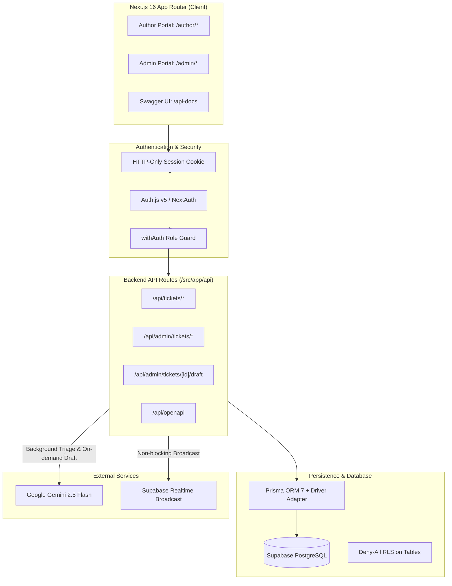

# BookLeaf — Author Support & Communication Portal

> **Live Web Application**: [https://bookleaf-brown.vercel.app](https://bookleaf-brown.vercel.app)

A full-stack, enterprise-grade Author Support and Communication Portal engineered for BookLeaf Publishing. Authors manage their published titles and raise support requests; the operations team uses a triage queue with real-time updates and **Gemini Flash**-powered AI assistance with zero-hallucination fact grounding, instant caching, and automated fallback.

---

## Table of Contents
1. [Demo Credentials](#demo-credentials)
2. [Key Capabilities](#key-capabilities)
3. [Architecture Overview](#architecture-overview)
4. [AI Module & Economics](#ai-module--economics)
5. [Interactive API Reference](#interactive-api-reference)
6. [Local Setup Runbook](#local-setup-runbook)
7. [Verification & Test Suite](#verification--test-suite)
8. [Known Limitations & Trade-offs](#known-limitations--trade-offs)

---

## Demo Credentials

All test accounts are seeded in the database. Passwords are case-sensitive.

### Operations & Support Team (Admin Portal)
Access portal at: [`https://bookleaf-brown.vercel.app/admin/tickets`](https://bookleaf-brown.vercel.app/admin/tickets)

| Name | Role | Email | Password | Scope |
| :--- | :--- | :--- | :--- | :--- |
| **Aarav Mehta** | Support Lead | `admin@bookleaf.com` | `Admin@123` | Full queue, triage, notes, AI drafts |
| **Nisha Rao** | Operations | `ops@bookleaf.com` | `Admin@123` | Full queue, triage, notes, AI drafts |

### Authors (Author Portal)
Access portal at: [`https://bookleaf-brown.vercel.app/author/tickets`](https://bookleaf-brown.vercel.app/author/tickets)

| Author Name | Author ID | Email | Password | Books Published | Key Test Scenario |
| :--- | :--- | :--- | :--- | :--- | :--- |
| **Ananya Reddy** | `AUTH003` | `ananya.reddy@email.com` | `Author@123` | 2 books | **Royalty Inquiry** (BK005: ₹14,280 pending) |
| **Priya Sharma** | `AUTH001` | `priya.sharma@email.com` | `Author@123` | 2 books | High volume seller (₹3,570 pending) |
| **Rohit Kapoor** | `AUTH002` | `rohit.kapoor@email.com` | `Author@123` | 1 book | Zero pending royalties test |
| **Dr. Vikram Malhotra** | `AUTH004` | `vikram.malhotra@email.com` | `Author@123` | 1 book | Non-fiction health title |
| **Meera Joshi** | `AUTH005` | `meera.joshi@email.com` | `Author@123` | 1 book | Poetry publication |
| **Arjun Nair** | `AUTH006` | `arjun.nair@email.com` | `Author@123` | 1 book | Regional travel literature |
| **Fatima Sheikh** | `AUTH007` | `fatima.sheikh@email.com` | `Author@123` | 1 book | Culinary non-fiction |
| **Rajesh Mukherjee** | `AUTH008` | `rajesh.mukherjee@email.com` | `Author@123` | 1 book | Crime thriller fiction |
| **Tanvi Shah** | `AUTH009` | `tanvi.shah@email.com` | `Author@123` | 1 book | Business biography |
| **Kabir Anand** | `AUTH010` | `kabir.anand@email.com` | `Author@123` | 1 book | Historical fiction |

---

## Key Capabilities

### 1. Author Experience
- **My Books Hub (`/author/books`)**: View live published titles, ISBNs, distribution channels (Amazon, Flipkart, BookLeaf Store), sales numbers, and calculated next royalty payout dates.
- **Ticket Creator (`/author/tickets/new`)**: Category selector with contextual help text, optional book association, priority guidance, and instant submission.
- **Real-Time Conversation Thread (`/author/tickets/[id]`)**: Full message timeline with distinct badges for Author vs BookLeaf Team, optimistic UI updates, and real-time subscription.
- **RBAC Isolation**: Authors can strictly only access tickets and books belonging to their authenticated profile.

### 2. Admin & Support Operations
- **Triage Queue (`/admin/tickets`)**: Live-updating ticket table with multi-factor filters (Status, Priority, Category, Assigned Admin), full-text search, and pagination.
- **Triage Controls**: Instant badge overrides for Status, Priority, and Category with immediate UI feedback and audit logging.
- **Internal Notes**: Private staff notes visible only to admins, rendered in distinct amber warning styling with lock icons.
- **AI-Powered Draft Assistant**: Pre-fills empathy-first draft replies grounded in authoritative company knowledge base and book sales data.

### 3. Real-Time Synchronization
- Backed by **Supabase Realtime Broadcast**.
- Server fires non-blocking HTTP broadcast events upon ticket creation, message posting, status change, or note additions.
- Browsers subscribe to channels and trigger smart query cache invalidation with audio/visual status indicators (`Connected`, `Reconnecting`, `Offline`).

---

## Architecture Overview



### Architectural Decisions
1. **Prisma ORM over Supabase Client**: Prisma provides end-to-end TypeScript types, strong migration tracking, and compile-time query safety. All database traffic originates from authenticated server-side route handlers.
2. **Deny-All Row-Level Security (RLS)**: PostgreSQL tables are locked down with `DENY ALL` policies. Direct client connections cannot bypass business logic; all access is strictly enforced via server-side session authentication.
3. **HTTP Broadcast as an Invalidation Signal**: Instead of sending sensitive ticket contents over client WebSocket channels, the server broadcasts lightweight `{ type: "TICKET_UPDATED", ticketId }` pulses. Subscribed clients re-fetch only the data their session is authorized to view.
4. **Next.js `after()` for Background Triage**: Ticket creation responds in <200ms. AI triage classification runs asynchronously in `after()`, logging telemetry and updating ticket triage without delaying author confirmation.

---

## AI Module & Economics

The portal uses **Google Gemini 2.5 Flash** via `@google/genai` with strict cost controls designed for free-tier sustainability (1,500 requests/day, 15 RPM).

### 1. Zero Hallucination Guarantee
- **No LLM Math**: All numeric data (sales totals, royalties earned, pending balances, next payout date) is computed deterministically in TypeScript (`src/server/ai/facts.ts`) before being injected into the prompt.
- **Isolated Knowledge Injection**: The context builder selects *only* the specific knowledge base section corresponding to the ticket's category (e.g. only Royalties policy, or only Print Quality policy) rather than dumping the entire handbook.
- **Strict Persona & Tone**: The model is instructed to lead with empathy, acknowledge author anxiety first, state exact timeline commitments, and sign off as `Warm regards,\nTeam BookLeaf Author Support`.

### 2. Smart Caching (`AiDraft` Table)
- When an admin opens a ticket, a draft is generated and persisted in PostgreSQL.
- **Reopening a ticket with unchanged message count returns the cached draft with 0 Gemini API calls**.
- Re-drafting only triggers when a new message is posted or the admin clicks **Regenerate Draft**.

### 3. Graceful Fallback
- If the Gemini API hits rate limits (HTTP 429), returns 503, or `AI_FORCE_FAIL=true` is set:
  - Triage instantly falls back to deterministic keyword regex heuristics (`src/server/ai/heuristicClassifier.ts`) with `source: "HEURISTIC"`.
  - Admin drafting displays a non-blocking notification banner (`AI Draft unavailable`) allowing admins to compose and send manual replies without disruption.

### 4. Token & Latency Profile (Empirical Live Metrics)
| Operation | Input Tokens | Output Tokens | Total Tokens | Latency | API Cost |
| :--- | :--- | :--- | :--- | :--- | :--- |
| **Ticket Auto-Triage** | ~380 tokens | ~70 tokens | ~450 tokens | 1.8s | Free tier |
| **Initial Reply Draft** | ~1,190 tokens | ~206 tokens | ~1,396 tokens | 7.9s | Free tier |
| **Cached Draft Access** | **0 tokens** | **0 tokens** | **0 tokens** | **1.7ms** | **$0.00** |

---

## Interactive API Reference

The portal provides an interactive OpenAPI 3.0 Swagger UI:
- **Web UI**: [`https://bookleaf-brown.vercel.app/api-docs`](https://bookleaf-brown.vercel.app/api-docs)
- **Raw OpenAPI JSON**: [`https://bookleaf-brown.vercel.app/api/openapi`](https://bookleaf-brown.vercel.app/api/openapi)

### Core Endpoints

| Method | Endpoint | Access Role | Description |
| :--- | :--- | :--- | :--- |
| `GET` | `/api/health` | Public | System status and database connectivity |
| `GET` | `/api/me` | Authenticated | Current user profile and author association |
| `GET` | `/api/me/books` | Author | Author's published books with royalty metrics |
| `GET` | `/api/tickets` | Author | Author's ticket history |
| `POST` | `/api/tickets` | Author | Create new ticket with async AI triage |
| `GET` | `/api/tickets/{id}` | Author | Ticket details and message thread |
| `POST` | `/api/tickets/{id}/messages` | Author | Post author reply message |
| `GET` | `/api/admin/tickets` | Admin | Filtered triage queue with search & pagination |
| `GET` | `/api/admin/tickets/{id}` | Admin | Admin ticket detail with internal notes |
| `PATCH`| `/api/admin/tickets/{id}` | Admin | Triage overrides (Status, Priority, Category) |
| `POST` | `/api/admin/tickets/{id}/messages`| Admin | Post official team reply (`usedAiDraft` tracked) |
| `POST` | `/api/admin/tickets/{id}/notes` | Admin | Post private internal note |
| `POST` | `/api/admin/tickets/{id}/draft` | Admin | Fetch or generate cached AI draft response |
| `POST` | `/api/admin/tickets/{id}/classify`| Admin | Force on-demand re-classification |

---

## Local Setup Runbook

### Prerequisites
- Node.js 20+ installed
- PostgreSQL database (or Supabase project)
- Google Gemini API key (free tier from Google AI Studio)

### Step 1: Clone and Install
```bash
git clone https://github.com/sky2d/bookLeaf.git
cd bookLeaf
npm install
```

### Step 2: Environment Variables
Create a `.env` file in the project root based on `.env.example`:
```env
# Database (Direct & Pooled connections)
DATABASE_URL="postgresql://postgres:[PASSWORD]@[HOST]:6543/postgres?pgbouncer=true"
DIRECT_URL="postgresql://postgres:[PASSWORD]@[HOST]:5432/postgres"

# NextAuth / Auth.js
AUTH_SECRET="generate-with-openssl-rand-hex-32"
NEXTAUTH_URL="http://localhost:3000"

# Supabase (for Realtime Broadcast)
NEXT_PUBLIC_SUPABASE_URL="https://[PROJECT-ID].supabase.co"
NEXT_PUBLIC_SUPABASE_ANON_KEY="[ANON_KEY]"
SUPABASE_SERVICE_ROLE_KEY="[SERVICE_ROLE_KEY]"

# Google Gemini AI
GEMINI_API_KEY="AIzaSy..."
```

### Step 3: Run Database Migrations & Seed
```bash
# Apply Prisma migrations
npm run db:deploy

# Seed initial 10 authors, books, and demo logins
npm run db:seed
```

### Step 4: Start Dev Server
```bash
npm run dev
```
Open [http://localhost:3000](http://localhost:3000) to view the application.

---

## Verification & Test Suite

The project includes automated test coverage spanning unit tests, integration tests, RBAC security smoke tests, and OpenAPI spec parity tests.

```bash
# Run Vitest test suite (182 unit tests across 26 test files)
npm test

# Run RBAC security smoke suite (37 role-permission assertions)
npm run smoke:rbac

# Run TypeScript typecheck
npm run typecheck

# Run ESLint validation
npm run lint
```

---

## Known Limitations & Trade-offs

1. **Next.js `after()` vs Durable Message Queues**:
   - `after()` executes background triage within the request lifecycle without worker infrastructure. In a high-concurrency production system, a durable queue (e.g. BullMQ, Celery, or AWS SQS) would provide retry guarantees across worker crashes.
2. **UI Attachment Placeholders**:
   - Attachment metadata is validated in the UI and stored in the database. Binary uploads to Supabase Storage private buckets with signed URLs were deliberately isolated to an optional enhancement to prioritize core support workflows.
3. **Email Notifications**:
   - Updates are delivered through in-app real-time banners and optimistic polling. Email delivery (e.g. Resend, SendGrid) is deferred to future operational integrations.
4. **Gemini Free-Tier Rate Limits**:
   - The free tier enforces 15 requests per minute. Our intelligent draft caching layer and zero-cost regex fallback shield operations from ever blocking staff workflows even during rate-limit spikes.
